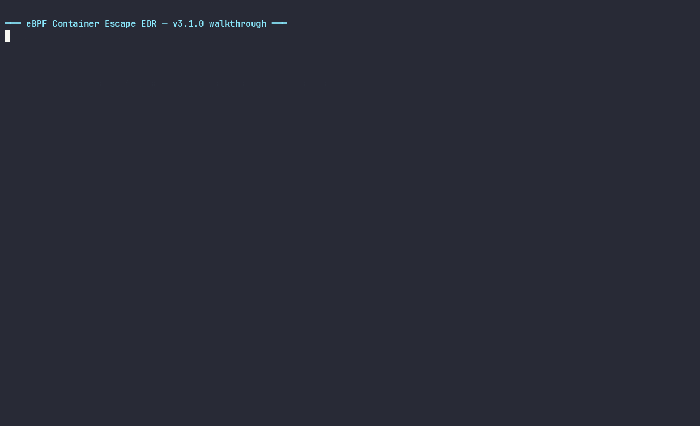

<div align="center">

# 🛡️ eBPF Container Escape EDR

**Audit only eBPF runtime sensor for Linux - container escape detection, hardened by design.**

[](https://github.com/0xmfbk/ebpf-container-escape-framework/actions/workflows/ci.yml)


**19 detection actions · 24 BPF programs · BPF-LSM resolved-path rules · IPv6 · wire format v4**



**Support the project:**

<p align="center">
  <a href="https://paypal.me/MUSTAFABANIKHALAF"></a>&nbsp;&nbsp;
  <a href="https://ko-fi.com/0xmfbk"></a>
</p>

</div>

> [!IMPORTANT]
> **Detection & audit only non enforcing.** No BPF program returns `-EPERM`;
> no syscall is ever blocked. This is a runtime observation plane, not a
> prevention plane. See [`docs/SECURITY.md`](docs/SECURITY.md) and [`THREAT_MODEL.md`](THREAT_MODEL.md).

---

## ✨ Highlights

| | |
|---|---|
| 🎯 **Canary files** | Plant invisible paths in a kernel O(1) map - any touch fires a `CRITICAL` alert instantly, including openat2 and probes of nonexistent files |
| 🛡️ **Evasion-resistant** | `openat2` hooked · `unshare(CLONE_NEWUSER)` escalates to `CRITICAL` · self-exclusion is PID-based (unspoofable via `prctl`) · `release_agent` matched anywhere under `/sys/fs/cgroup/` |
| 🧠 **BPF LSM mode** | On kernels with `bpf` in the active LSM list, `lsm/file_open` classifies **kernel-resolved** paths (`bpf_d_path`) - io_uring opens and user-string races closed in one step; falls back to tracepoints automatically |
| 🌐 **Full-stack network vision** | IPv4 **and** IPv6 connects with configurable suspicious-port severity |
| 📈 **Observability built-in** | Hand-rolled Prometheus `/metrics` (zero deps), `Sensor_Heartbeat` synthetic alerts for SIEM silence detection, `degraded`/`last_err` health fields |
| 🏥 **Self-healing** | systemd `Type=notify` + `WatchdogSec=30` and K8s liveness probes on a 10s heartbeat - a hung sensor restarts itself (verified live with SIGSTOP) |
| 🔐 **Least-privilege deployment** | `privileged: false` + `CAP_BPF/PERFMON/SYS_ADMIN` only, seccomp `RuntimeDefault`, Secrets for SIEM tokens, `system-node-critical` priority |
| ⚡ **Fast and small** | ~0.7% idle CPU, **0 ring-buffer drops at 25,000 forks**, 33–43 MB RSS, zero-dependency Go daemon |
| 📤 **SIEM-native** | JSON · ECS 8.11 · OCSF 1.3.0 · CEF · LEEF 2.0 → file/stdout/syslog/HTTPS-webhook (Splunk HEC) with batching, retry and circuit breaker |

---

## 🚀 Quick Start

```bash
git clone https://github.com/0xmfbk/ebpf-container-escape-framework.git
cd ebpf-container-escape-framework

make check-env                 # read-only probe: toolchain, BTF, tracefs, LSM, systemd
sudo make deps                 # one-shot bootstrap: clang, libbpf, bpftool, Go 1.26+
make kernel userspace emulation
sudo -E make verify            # full suite: 104 checks (97 core + 7 SIEM) on Debian/6.12
sudo ./install.sh              # systemd service (hardened unit, config preserved)
```

Requirements: kernel ≥ 5.15 with `CONFIG_DEBUG_INFO_BTF` (`/sys/kernel/btf/vmlinux`), root with `CAP_BPF CAP_PERFMON CAP_SYS_ADMIN`. `make deps`/`make check-env` work on Debian, Ubuntu and WSL2 ([`docs/WSL2.md`](docs/WSL2.md)).

---

## 📡 Detection Coverage - 19 actions

| # | Action | Severity | MITRE | Hook |
|--:|--------|----------|-------|------|
| 1 | `Container_Namespace_Unshare` |  | T1611 | kprobe `__x64_sys_unshare` - `CLONE_NEWUSER` escalates to  |
| 2 | `Container_Pivot_Root_Escape` |  | T1611 | kprobe `__x64_sys_pivot_root` |
| 3 | `Sensitive_File_Access` |  | T1003.008 | `/etc/shadow` · runtime sockets (docker/containerd/crio/k3s) |
| 4 | `Process_Execution` |  | T1059.004 | `sys_enter_execve` |
| 5 | `Network_Connection` | / | T1071 | `sys_enter_connect` - **IPv4 + IPv6**, configurable suspicious ports |
| 6 | `Process_Injection` |  | T1055.008 | `sys_enter_ptrace` |
| 7 | `Log_Tampering` |  | T1562.001 | `unlinkat` · `truncate` · `rename`/`renameat`/`renameat2` · write-intent opens (`O_TRUNC`/`O_WRONLY`) |
| 8 | `Ebpf_Tampering` |  | T1562.001 | `sys_enter_bpf` (load/attach/link cmds) |
| 9 | `Perf_Event_Open` |  | T1562.001 | `sys_enter_perf_event_open` *(suppressed by default)* |
| 10 | `Suspicious_Mount` |  | T1611 | `sys_enter_mount` |
| 11 | `Namespace_Switch` |  | T1611 | `sys_enter_setns` |
| 12 | `Chroot_Escape` |  | T1611 | `sys_enter_chroot` |
| 13 | `Executable_Memory` |  | T1620 | `sys_enter_mprotect` (PROT_EXEC) *(suppressed by default)* |
| 14 | `Core_Pattern_Modification` |  | T1611 | `core_pattern` · `modprobe` · `uevent_helper` |
| 15 | `Cgroup_Release_Agent` |  | T1611 | any `release_agent`/`notify_on_release` under `/sys/fs/cgroup/` |
| 16 | `Canary_Triggered` |  | T1552.001 | canary map hit - fires even for nonexistent paths |
| 17 | `Memfd_Create` |  | T1055.012 | `sys_enter_memfd_create` - fileless payloads |
| 18 | `Execveat` |  | T1620 | `sys_enter_execveat` - fd/memfd execution |
| 19 | `Kernel_Module_Load` |  | T1547.006 | `sys_enter_init_module` + `finit_module` |

**Two detection classes** for the file path rules (actions 3, 14, 15, 16):

- **Attempt-based** (canary, release_agent) → always on the `open`/`openat`/`openat2` tracepoints: they fire at syscall entry even when the target file doesn't exist - and on cgroup-v2 hosts, probing for `release_agent` *is* the attack.
- **Resolved-path** (shadow, sockets, kernel-helpers, log writes) → owned by `lsm/file_open` when the kernel's active LSM list includes `bpf` (kernel-resolved path via `bpf_d_path`, io_uring opens included), tracepoints otherwise. Exactly one event per open either way.

---

## 🏗️ Architecture

```
  KERNEL (24 programs)
  ├─ 23 syscall hooks (tracepoints + kprobes) ──► action_enabled gate
  │                                              └─► PID self-exclusion → comm/cgroup filters
  ├─ lsm/file_open (optional, resolved paths) ──► canary O(1) map · path classifiers
  └────────────────────────────► 1 MiB ringbuf · event_t v4 (224 B, zeroed)
                                        │
  USERSPACE (Go daemon, zero deps)      │
  ringbuf → bounded chan → enrich (container ID · cgroup path · lineage ≤16 ·
  K8s pod/ns/SA via LRU caches) → per-action token bucket → severity/MITRE
  → encoder (JSON/ECS/OCSF/CEF/LEEF) → sink (file/syslog/webhook) + Prometheus
  heartbeat 10s → systemd watchdog · K8s probes · Sensor_Heartbeat → SIEM
```

<details>
<summary><b>📦 Event schema (wire v4, 224 bytes)</b></summary>

```json
{
  "timestamp": "2026-10-25T01:21:51Z",
  "pid": 122934, "ppid": 122911, "uid": 0,
  "start_time_ns": 250042000000,
  "command": "adversary",
  "action": "Network_Connection",
  "target": "[::1]:4444",
  "severity": "HIGH",
  "mitre_id": "T1071",
  "mitre_technique": "Application Layer Protocol (Suspicious Port)",
  "cgroup_id": 4700,
  "cgroup_path": "/user.slice/user-0.slice/session-7.scope",
  "runtime": "host",
  "dest_ip": "::1", "dest_port": 4444,
  "lineage_summary": "systemd > sshd > sshd-session > zsh > sudo > adversary",
  "lineage": [
    {"pid": 122934, "ppid": 122911, "comm": "adversary",
     "exe": "/home/user/ebpf-container-escape-framework/emulation/adversary",
     "start_time_ns": 250042000000}
  ],
  "aux_u16": 0, "aux_u32": 0, "aux_u64": 0
}
```

Layout (natural alignment, asserted C↔Go at build time): `cgroup_id 0 · start_time_ns 8 · version 16 · action_id 20 · pid 24 · ppid 28 · uid 32 · flags 36 · comm 40 (16B) · filename 56 (128B) · dest_ip 184 (16B, IPv6-capable) · dest_port 200 · aux_u16 202 · aux_u64 208 · aux_u32 216`. The daemon rejects non-v4 records (`ver_mismatch` counter), so mixed old-object/new-daemon upgrades fail visibly.

</details>

<details>
<summary><b>⚙️ Configuration reference (TOML, <code>/etc/ebpf-edr/config.toml</code>)</b></summary>

Precedence: CLI > env (`EDR_*`) > file > defaults. Hot-reload: `systemctl reload ebpf-edr`.

```toml
mode = "audit"                      # "enforce" is rejected: audit-only build

disabled_actions = ["Perf_Event_Open", "Executable_Memory"]

[log]
path        = "/var/log/ebpf_edr.json"
max_bytes   = 52428800
max_backups = 5

[filter]
comm_allowlist   = []               # noise filter only - NOT self-protection
cgroup_allowlist = []
canary_paths     = ["/var/run/secrets/kubernetes.io/serviceaccount/token"]

[rates]
events_per_sec = 200                # per-action token buckets
burst          = 400

[context]
lineage_max_depth  = 16
lineage_cache_size = 20000
cgroup_cache_size  = 5000

[metrics]
enabled = false                     # Prometheus /metrics
bind    = "127.0.0.1:9400"

[sensor]
heartbeat_event = false             # INFO Sensor_Heartbeat each health tick

[network]
suspicious_ports = [4444, 1337, 31337, 6666, 6697]

[output]
format = "json"                     # json | ecs | ocsf | cef | leef
target = "file"                     # file | stdout | syslog | webhook

[output.webhook]
url         = "https://splunk.internal:8088/services/collector/event"
auth_header = "Splunk ${SPLUNK_HEC_TOKEN}"   # env-expanded - secrets stay out of files
splunk_hec  = true
```

Environment overrides include `EDR_CONFIG`, `EDR_LOG_PATH`, `EDR_MODE`, `EDR_WEBHOOK_URL`, `EDR_WEBHOOK_AUTH_HEADER`, `EDR_METRICS_ENABLED/BIND`, `EDR_SENSOR_HEARTBEAT`, `EDR_HEARTBEAT_PATH`.

</details>

---

## 📈 Observability

**Prometheus `/metrics`** (no client_golang - hand-rolled exposition, atomic reads):

```
ebpf_edr_build_info{version="3.1.0",event_version="4"}
ebpf_edr_events_total{action="Cgroup_Release_Agent"}     # per-action counters
ebpf_edr_events_dropped_total / rate_limited_total / ringbuf_read_errors_total
ebpf_edr_lineage_cache_entries / hits_total / misses_total
ebpf_edr_sink_sent|failed|dropped|retries_total · sink_queue · sink_circuit_open
ebpf_edr_logging_degraded · ebpf_edr_uptime_seconds
```

**Sensor silence detection** - `[sensor] heartbeat_event = true` ships a synthetic
`Sensor_Heartbeat` INFO alert every health tick; alert on its *absence* in the SIEM
(no heartbeat from a host in N minutes = dead, muted, or cut-off sensor). On by
default in the Kubernetes deployments.

**Health line** (60s, also `--health-interval`):

```
[health] recv=N written=N dropped=N rate_limited=N parse_err=N ver_mismatch=N
ringbuf_err=N reloads=N reload_fail=N chan=N/4096 lineage_cache=N/20000
lineage_hits=N lineage_misses=N cgroup_cache=N/5000 sink_sent=N sink_failed=N
sink_dropped=N sink_retries=N sink_queue=N sink_circuit=bool degraded=bool last_err="..."
```

Foreground testing: add `--quiet` to stop the stdout mirror (file/SIEM only).

---

## ☸️ Kubernetes & Helm

```bash
make docker-build        # pre-compile kernel/bpf_program.o first (host clang)

helm install ebpf-edr ./deploy/helm/ebpf-edr -n ebpf-edr --create-namespace \
  --set config.output.target=webhook \
  --set config.output.webhook_url="https://splunk.internal:8088/services/collector/event" \
  --set secret.create=true --set secret.splunkToken="your-hec-token"
```

The token lives in a **Secret** (`secret.yaml` template or `secret.existingSecret`),
injected as `SPLUNK_HEC_TOKEN` and expanded at load time - never rendered into the
ConfigMap. Pod security: `privileged: false`, capabilities `BPF+PERFMON+SYS_ADMIN`
only, seccomp `RuntimeDefault`, read-only rootfs, `system-node-critical` priority,
`checksum/config` rollout annotation, and liveness/readiness exec probes on the
daemon's heartbeat file. Raw manifests: `make k8s-apply` (namespace included).

systemd path (`install.sh`): `Type=notify` + `WatchdogSec=30`, `OOMScoreAdjust=-500`,
syscall allow-list (`@system-service @mount bpf perf_event_open`), address-family
restriction, `ProtectSystem=strict` & friends - `systemd-analyze security` exposure **2.7**.

---

## 🧪 Verification & Evidence

```bash
sudo -E make verify                       # 15 core + 2 SIEM stages
EDR_VERIFY_DESTRUCTIVE=1 sudo -E make verify   # + container smoke test (wipes Docker)
```

Latest full run - **v3.1.0 on kernel `6.12.111+deb13-amd64` (Debian 13)**:

- **97 PASS / 3 WARN / 0 FAIL** core + **7 PASS / 0 FAIL** SIEM
  (WARNs: intentional Docker-stage opt-in notice ×2, synthetic-workload CPU note)
- 24 BPF programs through the verifier, incl. `lsm/file_open` and all Phase D hooks
- Stage 13: 11/11 hook actions + nested release_agent suffix match + IPv6 + truncate tampering
- 25,000-fork stress: `recv=25010 written=25010 dropped=0`, lineage cache bounded at exactly 20000/20000
- Watchdog: SIGSTOP-frozen daemon detected and restarted by systemd within 30s
- Production: `[-] lsm/file_open attached` in the journal, `/metrics` live

CI gates every push (build, vet, race detector, fuzz smoke tests, kernel
build, emulation module). The runtime suite above runs on a kernel host -
nothing ships without a green run there first.

---

## 🔧 Development

| Target | Purpose |
|--------|---------|
| `make deps` / `make check-env` | Toolchain bootstrap / read-only environment probe |
| `make kernel` / `userspace` / `emulation` | Build BPF object / daemon / adversary harness |
| `make test` / `test-race` / `fuzz` | Unit tests / race detector / fuzzing (60s per target) |
| `make verify` / `verify-siem` | Full runtime suite / SIEM stages only |
| `make test-attacks` | Emulation coverage incl. canary + openat2 assertions |
| `make demo` | Record-ready feature walkthrough (see above) |
| `make install` / `uninstall` | systemd install (atomic, config-preserving) |
| `make docker-build` / `k8s-apply` / `k8s-delete` | Image / raw-manifest deployment |
| `make ci` / `clean` | Local CI gate / remove artifacts |

Adversary harness runs require `EDR_EMULATION_CONFIRMED=1` (in-repo callers set
it automatically) it fires real syscalls and belongs on disposable hosts.

---

## 📚 Documentation

| Doc | Contents |
|-----|----------|
| [`docs/ARCHITECTURE.md`](docs/ARCHITECTURE.md) | Data flow, kernel programs, maps, caches, wire versioning |
| [`docs/OPERATIONS.md`](docs/OPERATIONS.md) | Install, config, reload, troubleshooting |
| [`docs/SECURITY.md`](docs/SECURITY.md) | Threat model, capabilities, failure modes, audit-only posture |
| [`THREAT_MODEL.md`](THREAT_MODEL.md) | Trust boundaries, self-exclusion design, non-goals |
| [`docs/MITRE_MATRIX.md`](docs/MITRE_MATRIX.md) | Full technique mapping |
| [`docs/KERNEL_COMPATIBILITY.md`](docs/KERNEL_COMPATIBILITY.md) | Kernel floor, feature matrix, vmlinux.h pinning |
| [`docs/WSL2.md`](docs/WSL2.md) | Building & running under WSL2 |
| [`docs/RELEASE_v3.1.0.md`](docs/RELEASE_v3.1.0.md) · [`v3.0.0`](docs/RELEASE_v3.0.0.md) | Release notes |
| [`SECURITY.md`](SECURITY.md) · [`CONTRIBUTING.md`](CONTRIBUTING.md) · [`CODE_OF_CONDUCT.md`](CODE_OF_CONDUCT.md) | Disclosure policy · contribution workflow · community standards |

---

## 🤝 Contributing & Security

Contributions follow [`CONTRIBUTING.md`](CONTRIBUTING.md) - `make ci` must pass
locally before any PR. Vulnerability disclosure: see [`SECURITY.md`](SECURITY.md).

## License

MIT - see [LICENSE](LICENSE).
